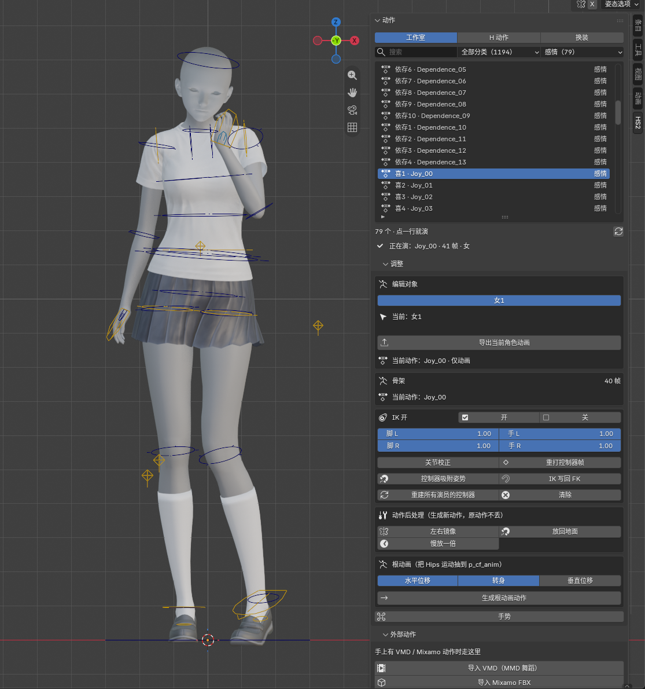

# HS2 AnimKit

把 **Honey Select 2** 的角色、动作和 H 道具直接搬进 Blender，改完再导出成 FBX。

你不需要先研究骨架、控制器或游戏文件结构。装好插件后，基本就是：

> **选一条动作 → 看 → 想改就拖控制器 → 导出。**

---

## 能做什么

- 载入 HS2 男女素模和游戏原骨架（素模自动套中性灰材质，方便看衣服颜色）
- 导入工作室 HS2MeshExporter 导出的角色 FBX：自动修骨架、对齐默认姿势，捏好的角色可直接套游戏动作
- 浏览、搜索并播放游戏里的 Studio 动作
- 播放 H 动作，自动安排人数、性别和道具
- 在 H 动作的阶段之间切换（待机、抽插、绝顶等）
- 用 FK / IK 控制器改姿势，或者直接改动作
- 左右镜像、慢放、放回地面、生成根运动
- 导入 MMD 的 VMD 和 Mixamo FBX
- 导出带骨骼动画的 FBX，给 UE / Unity / 其他引擎使用
- 按槽位给角色穿游戏里的衣服，一键分件导出衣服 FBX + 贴图

---

## 安装

### 需要什么

- Blender **4.0 或更新版本**（4.2 / 4.5 / 5.2 验证过）
- 一份已经安装好的 Honey Select 2
- 插件会读取游戏里的 `abdata` 数据，但**不附带任何游戏素材**

### 用 zip 安装（推荐）

1. 下载发布页里的 `HS2RigKit_addon.zip`
2. 打开 Blender：`编辑 → 偏好设置 → 插件`
3. 点右上角 `从磁盘安装`，选择这个 zip
4. 在插件列表里搜索 `HS2 Anim Kit`，勾选启用
5. 按 `N` 打开 3D 视图侧栏，找到 `HS2` 标签页

## 第一次使用

1. 打开侧栏的 `HS2 → 动作`
2. 第一次会要求选择 **HS2 游戏目录**
   - 选 `abdata` 的**上一级**目录，不是 `abdata` 本身
   - 例如 `D:\game\HS2`
3. 插件会自动建立动作索引
   - 第一次大约 30 秒
   - 之后会读缓存，基本秒开
4. 索引完成后，直接点列表里的动作就能播放

### 从工作室 FBX 导入（推荐，模型最完整）

如果角色已经在工作室用 HS2MeshExporter 导出成 FBX，在 `HS2 → 动作` 面板的 **演员** 那一行点最右边的
`📄` 按钮（**导入工作室 FBX**），或者用 `外部动作 → 工作室 FBX 角色`，选：

```
Export\2026xxxx_角色名\角色名.fbx
```

插件会自动做完这些：

- Armature 的 `0.01` 缩放改成 `0.1`，角色不再缩小 10 倍
- **保留全部 290 根骨**（手指末节、`_s` 副骨、眼球/瞳孔、vagina 骨一个不少），
  顶点组和权重跟 FBX 里一模一样
- **根骨收口**：删掉工作室套在 `p_cf_anim` 外面的 `BodyTop`，根骨就是 `p_cf_anim`
- 删除 482 个空物体（工作室的定位点）、相机、灯、Cube，只留骨架和角色网格
- 眼睛、牙齿、舌头、头模、体模网格全部保留，材质贴图不动
- **按 FBX 里的 BindPose 重建骨架**，骨头和蒙皮严格对齐（见下）
- **把骨架摆成插件默认骨架的姿势**：手臂平举的 T-pose、手指伸直，
  和 `p_cf_anim` 默认角色一模一样
- 标记成插件角色，之后点动作列表就能直接套，不用再做任何手动修正
- 骨架显示改为细线，避免异常骨长显示成大片锥体

这条路径比角色卡更完整：头模、脸型、体模（包括 Uncensor Selector 选中的 Roastie/HighPoly 等）都以工作室导出的实际网格为准。

姿势被改乱了以后，可以在 `编辑对象` 下面点 **对齐默认骨架姿势** 再来一次。

#### 为什么以前会骨骼错位

两个独立的问题，都会让蒙皮错：

1. **少了一半骨** —— 导入器开了 `ignore_leaf_bones`，HS2 的指尖、`_s` 副骨、
   眼球骨、vagina 骨都是"叶子骨"，被它删掉了（290 根只剩 256 根），
   这些骨上的权重跟着丢，指尖/会阴就错位。
2. **骨头比蒙皮大 11%** —— FBX 的 BindPose 带着角色体型缩放（这套是 `0.9`），
   导入器建 rest 时用 `bind_matrix.normalized()` 把缩放归一化掉了，于是整副骨架
   被放大 `1/0.9`，动画绕着错误的枢轴转、拉成带状。

插件现在保留全部骨，并且不再依赖导入器的 rest：直接读 BindPose，骨头位置取
BindPose 的平移、朝向取 BindPose 的旋转，于是骨头正好落在蒙皮里。缩放丢掉了
也没关系 —— 骨骼形变只跟旋转和骨头位置有关，把位置摆对就完全对齐。

> 注：HS2 的骨名里 `cf_J_Vagina_L.001`~`.005` 是**真的骨名**，不是 Blender 的重名后缀。

#### 动作是怎么对上的

游戏动作是**骨骼世界朝向的绝对值**，所以插件把每帧每根骨的世界朝向照抄到角色
骨架上，再按角色自己的骨长和比例反解成局部值：

- 不会出现手臂带状拉伸、胸/头塌陷（骨长沿用角色自己的）
- 手指/关节不会被拉断：有位移轨道的骨按"父骨空间的局部位移"处理，
  不是直接套世界坐标
- **骨骼缩放也一起传**：游戏动作会把手肘/膝盖的 `*_dam` 补偿骨拉到 1.05~1.23，
  不传的话关节会塌（实测世界缩放 1.093 现在能对上）
- 根位移按身高比缩放，脚不会离地
- L/R 自动按世界 X 位置配对：工作室导出把 X 镜像了（FBX 里的 `*_L` 落在 +X，
  游戏里 `*_L` 在 -X），照名字硬套会让手臂横穿身体

验收脚本：`tools/test_fbx_rig.py`（用插件默认角色当参照，逐个动作比较网格边长伸缩）。
和 Better FBX 的逐项对比（骨名、rest 位置/朝向、父子关系、权重、蒙皮顶点）
写在 [`docs/工作室FBX导入.md`](docs/工作室FBX导入.md)：骨头位置最大差 0.0000，
权重 32313 项 0 处不一致，套同一条动作后顶点最大差 0.0012 单位。

### 从角色卡加载（不经过工作室）

`外部动作 → 手动放人 → 从角色卡加载…`，选 `UserData/chara/female` 或 `male` 里的 PNG 卡即可。

- 直接读卡里的 `Custom` / `Coordinate`，不需要 Studio，也不需要 MeshExporter
- 骨架用插件的 `p_cf_anim`，手型保持默认微弯，不是 MeshExporter 的平手 T-pose
- 套用 `shapeValueBody` / `shapeValueFace`：按游戏 `cf_anmShapeBody`、`cf_anmShapeHead_00/01` 的曲线和骨骼映射还原
- 目标骨从 rest 初始化，只覆写游戏明确写入的分量，避免胸/头被拉回父骨
- 卡里的 `headId` 会匹配对应头模 bundle，脸部曲线用 `_00/_01` 对应版本
- 体模额外骨（高面数、阴道骨等）会从 body mesh 的 bone 列表补进骨架
- 已接：身体/头部、肤色、卡片身高、卡里穿的衣服（按 8 个衣服槽）
- 暂未接：卡里的自定义头发、皮肤/脸部贴图、衣服颜色；Uncensor Selector 的运行时体模需要单独选择

---

## 五分钟上手

### 1. 播一条 Studio 动作

打开 `HS2 → 动作`，上方选 `工作室动作`：

- 在搜索框里输入动作名的一部分
- 用右边的分类 / 小类下拉缩小范围
- **点一行就开始播**
- 需要的人（和道具）会自动进场

底部显示当前列表数量和刷新按钮。只有游戏里新增了动作包时，才需要手动点刷新。

### 2. 播一段 H 动作

切到 `H 动作`：

- 上方可以筛选人数：全部 / 单人 / 男女 / 百合 / 3P
- 可以搜索日文名
- 右边的道具开关决定要不要一起加载道具
- **点一行 = 自动放好所有演员和道具，并开始播放**

选中一段 H 动作后，下方会出现它的阶段列表：

- 待机
- 抽插、弱 / 中 / 强
- 绝顶
- 等等

**点阶段只会切动作阶段，不会重新换人。** 多人动作会一起切换。

有男角的 H 动作会自动给男角色加载男性生殖器（`oo_base` 里的
`cm_o_dan00` / `cm_o_dan_f`），跟着 `cm_J_dan_*` 骨骼一起播；
百合、单人这类没有男角的动作不会加载。

### 3. 改姿势

打开 `HS2 → 调整`。

如果场景里有多个演员，顶部会出现 `编辑对象` 按钮。先点一下你要改的人，下面的工具只对他生效。

第一次改动作前，先加控制器：

- 点 `给所有演员加控制器（FK + 手脚 IK）`
- 需要手指控制器时，勾选 `连手指一起做`
- 一般不用勾，手部姿势可以用现成的手势

加完以后：

- 直接拖场景里的控制器改姿势
- 每个手脚控制器都有 `ik` 滑块：`0` 是 FK，`1` 是 IK
- `关节校正` 控制膝盖、手肘等位置的补偿骨
  - 播游戏动作时默认关闭，保持和游戏一致
  - 自己改关节，或导入 VMD 时，再打开

改完姿势后，可以：

- `重打控制器帧`：把控制器当前的位置写进整段动作
- `控制器吸附姿势`：让控制器跟上当前骨骼
- `IK 写回 FK`：把 IK 结果写回 FK 骨骼

### 4. 手势

在 `调整` 里展开 `手势`：

1. 左右手各选一个手势（共 21 种）
2. 选择是否在当前帧写关键帧
3. 点 `写入关键帧`
4. 点 `还原` 可以恢复原来的手部姿势

选手势时就会预览，不会立刻改动画。

### 5. 动作列表（不折叠体型）

动作列表直接列出每一个具体动作，不再把 `_S / _M / _L` 折叠成身高档位，也不再有身高/胸围切换。搜 `turn_L` 就能直接看到左转动作；每个动作都可以单独加载、改、导出。

搜索会同时匹配内部动作名和官方表示名（比如 `90回転`、`男 90回転 L`），不会只搜英文内部名；没有结果时搜索框会保留，只显示“没有匹配的动作”。

### 6. 动作后处理

`调整` 里的 `动作后处理` 会生成一条新动作，原动作保留：

- `左右镜像`：左右互换
- `放回地面`：把角色整体挪回地面，不改变姿势
- `慢放一倍`：帧数翻倍，做慢镜头或补细节

需要把 Hips 的运动抽到根骨时，用 `根动画`：

- `水平位移`
- `转向`
- `垂直位移`

勾选需要的项目，再点 `生成根动画动作`。

### 7. 导出 FBX

侧栏 `HS2` 里的 **导出** 面板（在 `调整` 下面，默认展开），四个按钮都是给引擎用的，
单位已经处理成厘米：

| 按钮 | 导出什么 |
| --- | --- |
| 导出模型（骨架 + 网格） | 骨架 + 这个角色全部蒙皮网格（身体、头、眼睛、衣服），rest 姿势 |
| 导出模型 + 当前动作 | 同上，再把当前这条动作烘焙进去 |
| 只导当前动作（不含网格） | 只导骨架和动画，模型已经在引擎里时用这个 |
| 按物体导出（道具/衣服）… | 选中的道具各导一个 FBX，也能合成一个 |

`动作` 面板最底下也有两个快捷键（`模型` / `当前动作`），不用翻面板。

**只导当前角色的动作（给 UE / Unity 用）**

1. 在 `动作` 面板的 `演员` 里点一下要导出的角色
2. `导出` 面板 → `只导当前动作（不含网格）`，选保存位置

导出的 FBX 只有这一个角色的骨架和**当前这条动作**，不带身体/头部网格。
IK、手势、动作后处理的结果会按当前画面烘焙进去；按钮内部已经关掉
「所有动作」和「NLA」，不会把动作库里的其它动画一起带出去，
UE 里导入出来就是一条干净动画，名字跟动作名一致。

**要连模型一起导**就用 `导出模型（骨架 + 网格）`（模型 + 动作选另一个按钮）。
不要走 `文件 → 导出 → FBX`：那条路的单位处理和插件不一样，进 UE 后
根骨 `p_cf_anim` 的缩放会变成 100，详见下面的「UE 的单位」。

**UE 根运动**

1. 先导入骨架 FBX，确认 Skeleton 树的根骨是 `p_cf_anim`
2. 再导入动画 FBX，`Skeleton` 选刚导入的骨架
3. 导入对话框的 `Animation` 里勾 **Enable Root Motion**，`Root Motion Root Lock` 选 **Ref Pose**
4. 导入后打开动画资产，确认 `Asset Details → Root Motion → Enable Root Motion` 已勾选并保存

4.5.5 起 UE 导出不再把 Armature 物体临时改名成 `p_cf_anim`，避免物体和根骨同名被 UE 合并/丢弃，导致动画的根骨轨道对不上。

#### UE 的单位：根骨缩放必须是 1

UE 的骨架以**厘米**为单位，Blender 场景是米。Blender 的 FBX 导出器默认把这层
换算记在**文件单位**上（`UnitScaleFactor = 100`），几何数据仍是米；UE 5.x 的
导入器读到之后，会把「米 → 厘米」这 100 倍乘到**根骨** `p_cf_anim` 上：

- 模型大小是对的，但 `p_cf_anim` 的缩放是 **100**
- 跟别的骨架做「兼容骨架 / Compatible Skeleton」重定向时，根骨缩放不一致，
  动画会被放大或压扁

5.0.3 起插件在导出时直接把数据换成厘米（骨头位置、蒙皮顶点、姿势位移 ×100，
`UnitScaleFactor = 1`），于是 UE 导入不做任何换算，`p_cf_anim` 的缩放就是 1，
和默认骨架、混用其它骨架都一致。

**所以不要再手动填 `Import Uniform Scale`**：那个值会乘到根骨上，填 100 就是
把根骨缩放又变成 100（等于 10000）。5.0.3 之前导出的 FBX 要重新导一次
（骨架和动画都要重导），UE 里删掉旧资产再导入。

也别用 **文件 → 导出 → FBX**（Blender 默认 `Apply Scalings: All Local`）：它会把
100 记在骨架节点上 —— 默认角色出来根骨 100、工作室 FBX 角色出来根骨 10。导出对话框
里那 8 种缩放组合我都试过，没有一种能给出根骨 1。用侧栏 **导出** 面板的按钮才会写厘米。

验收：`blender -b --factory-startup --python tools/test_ue_export.py`，会检查
文件单位、骨架/根骨缩放、骨头数值是不是厘米，以及导出后场景是否原样还原。

---

## 换装

侧栏 `HS2` 顶部切到 `换装` 页。

1. 先加载一个角色（在 `动作` 里点一条动作，或在换装页点 `+ 女角` / `+ 男角`）
2. 选槽位（上衣 / 下衣 / 内衣上下 / 手套 / 袜子 / 鞋子 / 连裤袜），搜索并点一件
3. 选 `A` / `B` 状态，点 `穿上`；同槽位再穿会直接换掉旧的
4. `脱下` 清掉当前槽位；切到 `全部` 槽位再点就是清空这个角色所有衣服

所有衣服都会有一个 `默认` 按钮，对应不带后缀的原版/不脱状态；有 a/b
分支的再按实际网格追加 `半脱` / `全脱`（没有对应网格的状态不会显示）。
默认优先取分支外的本体网格；没有本体网格时退回第一个有网格的状态（通常 A）。

预览材质按 HS2 的 Clothing shader 还原：

- `MainTex RGB × _Color` 作基础色
- `_Color2/_Color3/_Color4` 是图案色，用 `ColorMaskTex` 的 R/G/B 通道分区叠上去（领子、袖口、花纹）
- `_BumpMap` 接法线
- 材质颜色是 sRGB，进 Blender 前会转成线性值，避免整件发白
- `MainTex` 的 A 通道不整件当 Alpha：大身只切掉「黑底 + A<0.5」的贴纸边框；扣子/警徽这类小面片强制用 Alpha，避免黑底方框，同时白色领子不会消失

贴图和 UV 按游戏的 V 方向翻转过，不会上下颠倒地平铺。

主贴图以衣服列表里的 `MainTex` 为准；材质自身 `_MainTex` 为 0 时会自动
按列表补上，法线/金属/遮挡图按 `_t/_n/_s/_o` 命名推导。

衣服是直接绑到当前角色骨架上的，会跟着动作和 IK 一起动。

### 导出当前穿搭

只导出当前角色**身上正在穿的衣服**，不会把整个游戏的衣服全导出来。

- 点 `导出当前穿搭`：每个槽位穿的那一件各生成一个 FBX（一件衣服有多个网格也只算一个文件）
- 只导当前穿的那个状态（`默认` / `半脱` / `全脱`），不会把同款的其它变体一起带出去
- 输出目录**默认留空**；留空时保存到 `.blend` 文件旁边的 `hs2_clothes` 目录
- 输出结构：`<输出目录>/<性别>/<槽位>/<资产名>/<资产名>.fbx`
- 贴图按材质和通道分开写在同目录的 `textures/` 下，文件名前缀就是衣服资产名
- `跳过已有` 默认开启：重跑时已经有同名 FBX 的直接跳过；想强制重导就关掉

---

## 外部动作

`动作 → 外部动作` 是另一种用法：动作不是来自 HS2，而是你手上的 VMD 或 Mixamo FBX。

### VMD

点 `导入 VMD（MMD 舞蹈）`，选择 `.vmd` 文件。

- 默认使用虚拟 MMD 骨架，保留 MMD 的 IK、扭转骨和角色配置
- 可以在导入选项里选 `chara_*.ini` 角色配置
- 没有演员时会自动放一个
- VMD 不做贴地，脚在哪儿就是哪儿

### Mixamo FBX

点 `导入 Mixamo FBX`，选择带皮肤的 FBX。

- 按 `mixamorig:*` 骨骼名自动映射
- Foot / ToeBase 会分别驱动 HS2 的脚骨和脚趾骨
- 体型差会按身高比例缩放
- 导入时可以顺便做足部贴地和关节校正

### 手动放人

展开 `手动放人（自制动作用）`：

- `+ 女角`
- `+ 男角`
- 点角色名切换当前编辑对象
- 点后面的 `X` 删除角色

## 许可

本项目按 **GPL-3.0** 发布，见 [`LICENSE`](LICENSE)。插件内打包的第三方组件及许可证见 [`THIRD_PARTY.md`](THIRD_PARTY.md)。

本仓库不包含任何游戏素材。使用插件时需要你合法拥有对应的游戏和文件。
